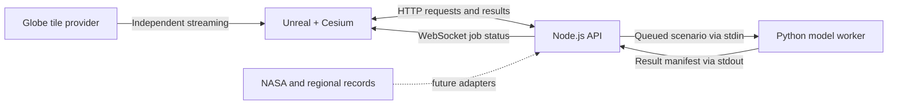
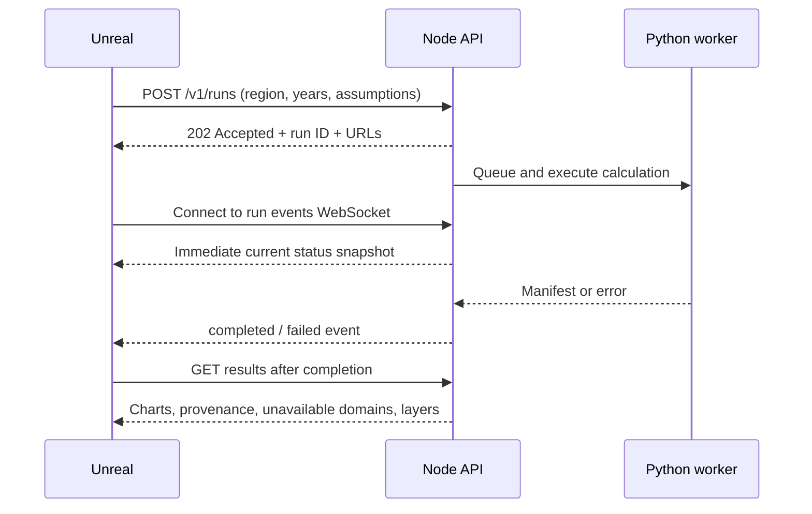

# Goofy Goobers - Data Center Impact Platform

NASA Space Apps Challenge 2026: **[Be An Earth System Trend Detective!](https://www.spaceappschallenge.org/2026/challenges/earth-system-trend-detective/)**

Explore how environmental and community conditions change around data-center clusters, then compare conditional future scenarios for facility expansion, cooling, electricity sources, and operating choices.

The full intended scope includes **air pollution and air quality; water use, availability and quality; electricity consumption; facility and household electricity bills; employment and unemployment rates; population and growth rates; land/ecosystem indicators; and noise pollution**. Historical NASA observations and trend significance remain central to the challenge. Future estimates must distinguish assumptions from observations and association from causation.

## Current state

This is an initial repository foundation, not a finished predictor. It includes a runnable local **Node -> queued Python worker -> result manifest** workflow, HTTP status/results, WebSocket notifications, shared contracts, synthetic inputs, and integration tests.

The demo produces four transparent annual accounting series from invented inputs: facility electricity, grid-electricity CO2e, onsite cooling-water **use**, and a fixed-price facility energy bill. All results are labeled `illustrative`, use synthetic provenance, and report uncertainty as `not_quantified`. The remaining domains return explicit reasons under `unavailable`; map `layers` is empty.

**There are no live NASA adapters, calibrated pollution/hydrology/acoustic models, economic or demographic forecasts, or compiled Unreal project yet.** Selecting a future year only extends the supplied arithmetic assumptions; it does not demonstrate predictive skill.

## The three main parts

| Part | General explanation | Where it lives |
| --- | --- | --- |
| **1. Data and backend** | Collect evidence, normalize it, manage scenarios/jobs, preserve provenance, and provide the client API | `apps/api/`, `packages/contracts/`, `data/` |
| **2. Projection engine** | Run versioned accounting and future scientific/economic models with explicit scales, supported horizons, and uncertainty | `services/models/` |
| **3. Interactive explorer** | Navigate the globe, select facilities, adjust assumptions, compare timelines, and display results with evidence labels | `clients/unreal/` |



## Repository structure

```text
.
|-- apps/api/src/             # Local Node/TypeScript API and in-process FIFO queue
|   |-- server.ts             # HTTP endpoints and read-only WebSocket event streams
|   |-- run-manager.ts        # queued -> running -> completed / failed
|   |-- model-worker.ts       # Async Python process, timeout and output validation
|   `-- validation.ts         # Shared JSON Schema and cross-field checks
|-- services/models/          # Python standard-library-only accounting worker
|   |-- accounting.py         # Validated formulas, metadata and unavailable domains
|   |-- worker.py             # One stdin request -> one stdout manifest
|   `-- tests/                # Numerical, validation and process-protocol checks
|-- packages/contracts/       # JSON Schemas, TypeScript types and domain registry
|-- clients/unreal/           # Unreal/Cesium implementation track, not a .uproject
|-- data/
|   |-- examples/             # Small synthetic scenario fixture
|   |-- raw/                  # Future source downloads; generated contents ignored
|   |-- processed/            # Future normalized observations and layers; ignored
|   `-- runs/                 # Future local artifacts; current runs are in memory
|-- docs/
|   |-- architecture.md       # Component boundaries, lifecycle and evolution
|   |-- api.md                # HTTP, WebSocket, worker and manifest contracts
|   |-- unreal-integration.md # Globe, networking, UI, terrain and acceptance checks
|   |-- modeling.md           # Domain models, attribution, validation and uncertainty
|   |-- resources.md          # All 13 challenge resources plus repositories/sources
|   `-- roadmap.md            # Milestones and completion criteria
|-- scripts/demo.ts           # Submit, subscribe, poll and fetch an actual demo run
|-- tests/api.test.ts         # HTTP/WS/real Python integration and failure paths
`-- .github/workflows/ci.yml  # Linux + Windows checks
```

## Run the local starter

Prerequisites: **Node.js 24.12+** (supported majors 24-26), npm, and **Python 3.11+** available as `python`. Unreal, a GPU, Earthdata credentials and Google/Cesium accounts are not required for this demo. TypeScript executes through Node's built-in type stripping; `npm run typecheck` performs the separate static check. See [Node's TypeScript documentation](https://nodejs.org/api/typescript.html).

```sh
git clone https://github.com/Moustafa-FD/NasaSpaceHacks2026GoofyGoobers.git
cd NasaSpaceHacks2026GoofyGoobers
npm ci
```

Optional environment setup:

```sh
# macOS/Linux
cp .env.example .env
```

```powershell
# PowerShell
Copy-Item .env.example .env
```

If Python is not available under `python`, set `PYTHON_EXECUTABLE` in `.env` to its executable name or full path. The runtime worker uses that setting. The `test:models` script uses `python` directly; invoke the same `-m unittest discover -s services/models/tests -v` arguments with your chosen executable if needed.

Start the API in terminal 1:

```sh
npm start
```

Run the end-to-end client in terminal 2:

```sh
npm run demo
```

It submits [the synthetic example](data/examples/scenario.json), prints WebSocket status snapshots, polls authoritative HTTP status, and prints the completed manifest. Polling and notification handling are bounded; failures and timeouts are reported rather than converted into numbers.

Local defaults: `http://127.0.0.1:3000`, one active worker, at most 32 waiting runs, at most 200 stored runs per process, 64 event clients, a 64 KiB request limit, and a 30-second worker timeout. Limits reject excess work explicitly. There is no durable database or public authentication: restart clears runs/results, and the server binds to loopback only. A deployed service needs a deliberate HTTPS/WSS/authentication and persistence design.

Commands:

| Command | Purpose |
| --- | --- |
| `npm run dev` | Watch API source and restart on changes; a restart clears runs |
| `npm run typecheck` | Check TypeScript contracts and API code |
| `npm test` | Exercise HTTP, WebSockets and the real Python worker |
| `npm run test:models` | Check hand-computed accounting, units, leap years and invalid inputs |
| `npm run check` | Run all required checks |

## 1. Data and backend - implementation work

**Implemented:** scenario validation, an in-memory run registry and FIFO queue, asynchronous worker execution, typed contracts, result validation, HTTP status/results, and WebSocket notifications.

**Next:**

1. Select one pilot cluster with accessible facility and environmental records. Document opening dates, IT versus facility capacity, utilization, PUE, cooling/WUE definitions, water source/returns, generator schedules and staffing. Do not infer private operating figures from a building footprint.
2. Implement one quality-controlled NASA time-series adapter, using [GES DISC tutorials](https://github.com/nasa/gesdisc-tutorials), [Giovanni](https://giovanni.gsfc.nasa.gov/), and/or [AppEEARS examples](https://github.com/nasa/AppEEARS-Data-Resources). Preserve collection versions, quality flags, resolution, units, citations and retrieval dates.
3. Add regional utility, water-monitoring, labor and census records. Map each facility to its watershed/aquifer, airshed, utility service area, and labor/census region rather than using one radius for everything.
4. Store observations separately from assumptions. Add historical trend magnitude, significance, comparison areas and missing-data handling.
5. Replace the demonstration registry with persisted run records, a durable job queue, PostGIS for geographic entities, and object storage for larger products. Those infrastructure components are planned, not current prerequisites.

## 2. Projection engine - implementation work

| Domain | Current state | Required implementation |
| --- | --- | --- |
| Electricity | Illustrative facility kWh/year | Time-varying IT load, efficiency, cooling and peak demand; historical validation |
| Emissions / air quality | Illustrative grid CO2e inventory only | Onsite sources, offsite generation, emissions inventories, transport/chemistry, ground calibration and appropriate AQ indicators |
| Water availability | Illustrative onsite water-use total only | Withdrawals versus consumption/return flows, seasonal supply, competing users, watershed and groundwater dynamics |
| Water quality | Unavailable | Discharge volume, chemistry, treatment, temperature, receiving-water observations and transport/reactions |
| Electricity bills | Illustrative fixed-price facility energy charge only | Facility tariffs/demand charges and a separate household-rate model, inflation basis, grid investment and cost allocation |
| Employment / unemployment | Unavailable | Temporary construction versus permanent jobs, local hiring/commuting, labor force and participation; correct rate denominators |
| Population / growth | Unavailable | Appropriate local baseline, births, deaths, migration, age structure and explicit development assumptions |
| Land / ecosystems | Unavailable | Quality-controlled surface temperature, vegetation/land-cover and habitat indicators, with supported impact interpretation |
| Noise pollution | Unavailable | Equipment sound power/spectra, schedules, background measurements, receptors, propagation/barriers, mitigation and acoustic validation |

The demo formulas are deliberately inspectable:

```text
IT kWh = starting IT MW * 1000 * utilization * calendar hours * (1 + growth)^(year - start)
Facility kWh = IT kWh * PUE
Grid tonnes CO2e = facility kWh * supplied kg CO2e/kWh / 1000
Cooling water use (litres) = IT kWh * supplied litres/IT-kWh
Facility energy charge = facility kWh * supplied price/kWh
```

These use actual leap-year hours, fixed supplied factors, and no learned climate or economic relationship. Water use is not net consumptive loss or water quality; CO2e inventory is not local pollutant concentration; an energy charge is not a complete tariff or a household bill. See [worker formulas](services/models/README.md).

For **2030/2050/2100 scenarios**, use supported climate inputs such as [NASA NEX-GDDP-CMIP6](https://ntrs.nasa.gov/citations/20240011616), then calibrated domain-specific models and explicit growth/policy assumptions. Availability of climate scenarios through 2100 does not validate every social or environmental metric to that date. [STRATA](https://huggingface.co/nvidia/strata) is an optional short-range atmospheric research adapter; autoregressive feedback does not establish decades-ahead accuracy. [Its paper](https://arxiv.org/abs/2606.31248) reports stable 24-hour rollouts and growing biases.

Every future result must record evidence class, native resolution, supported horizon, provenance, model version and uncertainty method. A low/central/high sensitivity range is not automatically a confidence interval. Compare an explicit no-additional-expansion baseline against interventions; do not attribute all nearby changes to data centers. [Modeling plan](docs/modeling.md)

## 3. Unreal + Cesium - implementation work

**Documented, not compiled:** follow [the client track](clients/unreal/README.md) and [integration guide](docs/unreal-integration.md). Record compatible engine/plugin versions when creating the actual Unreal project.

Build globe navigation, facility selection, historical/future timelines, evidence-aware charts, scenario controls and comparisons. Future layers cover air quality, water availability/quality, land conditions, population/employment and noise. Until a model exists, display its unavailability explanation instead of a zero, plume, contour or invented map.

Use [Cesium for Unreal](https://cesium.com/learn/unreal/unreal-quickstart/) and optionally [Google Photorealistic 3D Tiles](https://cesium.com/learn/unreal/unreal-photorealistic-3d-tiles/). A detailed globe does not improve scientific resolution. Stream the base map independently from the backend's numerical outputs and preserve [provider attribution/data-use requirements](https://developers.google.com/maps/documentation/tile/policies).

For local terrain editing, use independently sourced elevation/geometry and your own Landscape or dynamic mesh. Streamed Google tiles are not editable Unreal Landscapes. Visual clipping also needs separate collision handling. Terrain/facility edits become simulation inputs only when a relevant model supports the numerical change; otherwise they remain visual scenarios.

### How Unreal communicates



| Operation | Actual starter interface |
| --- | --- |
| Discover status/capabilities | `GET /health`, `GET /v1/domains` |
| Start a calculation | `POST /v1/runs` returns immediately with a queued run ID |
| Check status or recover a disconnect | `GET /v1/runs/{id}` |
| Receive notifications | `ws://127.0.0.1:3000/v1/runs/{id}/events` |
| Download completed output | `GET /v1/runs/{id}/results` |

Unreal talks to the Node gateway for simulation work, not each model separately. Implement an asynchronous HTTP/WebSocket connector, expose its events to Blueprint widgets, and keep network waits off the rendering path. The event stream sends the latest snapshot on connection; HTTP status is authoritative after reconnect. It does not accept commands or promise replay.

Cache completed results by run ID. **Moving the timeline reads saved samples; pressing Run scenario after changing assumptions creates a new job.** In future, large layers will be fetched separately using result-manifest URLs. The initial `layers: []` intentionally supplies no map surfaces. Local HTTP/WS becomes authenticated HTTPS/WSS for deployment. See [exact payloads and failure handling](docs/api.md).

## Resources and next steps

The [resource catalog](docs/resources.md) includes **all 13 official challenge entries**, the NASA repositories discussed, and sources needed beyond NASA: tariffs/grid records, ground water-quality measurements, labor/census statistics and acoustic measurements. Links are references for planned adapters, not claims that integrations already work.

Start with the [roadmap](docs/roadmap.md), then use [contribution guidance](CONTRIBUTING.md). Data/product licenses and API-provider terms must be tracked separately. A project code license has not yet been selected; this starter does not invent ownership or relicense linked resources.
