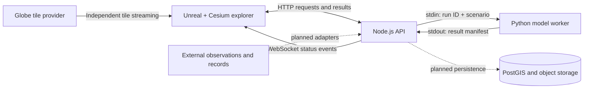
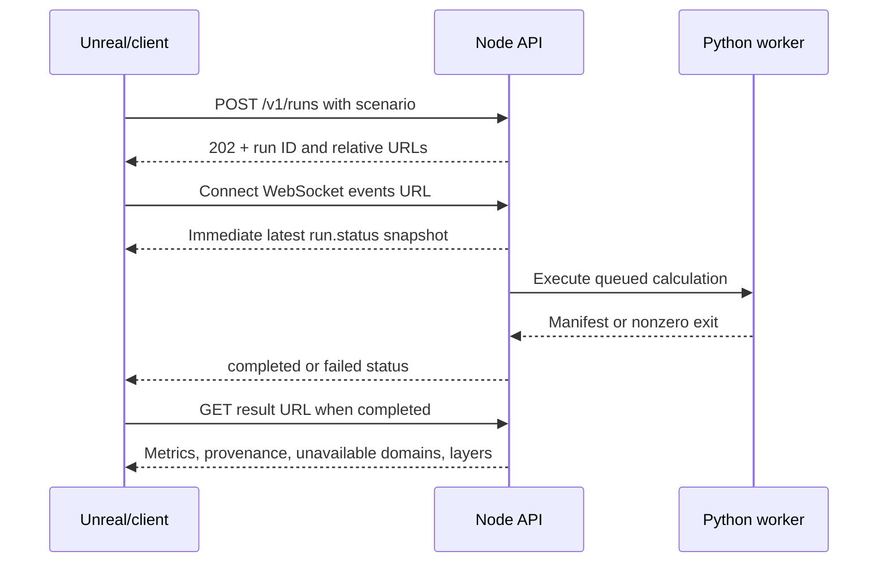

# Architecture

The system has three parts: a data/API backend, a projection engine, and an Unreal explorer. The first vertical slice runs locally and uses explicitly synthetic scenario assumptions. It demonstrates communication and accounting, not validated environmental or socioeconomic forecasting.

| Part | Responsibility | Starter state |
| --- | --- | --- |
| 1. Data and backend | Own scenario validation, run lifecycle, evidence metadata, and client communication | Node.js API with an in-memory run registry |
| 2. Projection engine | Execute versioned models and return a common result manifest | Python worker with illustrative electricity, grid-emissions, cooling-water-use, and facility-bill arithmetic |
| 3. Interactive explorer | Select regions, compare time series, edit scenario assumptions, and display georeferenced layers | Unreal/Cesium integration plan; no compiled Unreal project is supplied |

## Component boundaries

Unreal sends simulation requests to Node, not directly to individual scientific workers. Cesium streams the base globe independently. Model outputs must come from this project's permitted data sources; Google globe imagery is a visualization background, not a source to extract into the models.

## 1. Data and backend

The backend will combine NASA observations with facility records, utility data, water monitoring, demographic statistics, and labor data. Each adapter should preserve source URL/DOI, access date, license, version, units, missing values, quality flags, geographic coverage, and native time/spatial resolution.

Map facilities to the right analysis boundaries instead of using one radius for everything:

- Watershed and aquifer for water availability and quality.
- Airshed and receptor locations for air quality and noise.
- Utility service area/grid region for electricity and bills.
- Administrative and labor-market boundaries for employment and population.

Keep observations, reported facility values, estimates, and user assumptions distinguishable. Facility demand and staffing are not always public; absent values should remain absent or become explicit scenario assumptions.

The starter does not ingest live NASA data. It validates the example scenario, queues a local worker, holds run state in memory, and serves results. Restarting the API removes those runs. See [the API contract](api.md).

## 2. Projection engine

The intended model domains include air emissions and air quality; water availability and quality; electricity consumption and facility/household bills; employment and unemployment; population; land/ecosystem indicators; and noise pollution.

Only four illustrative accounting outputs exist initially. They cannot establish pollutant concentrations, watershed stress, contamination, household rate changes, unemployment, population growth, ecosystem damage, or acoustic levels. Those domains return explicit unavailability rather than fabricated numbers.

Each future model should have:

1. A defined input/output contract and supported geographic scale/horizon.
2. A baseline and intervention scenario with compatible assumptions.
3. Historical calibration, held-out validation, and documented limitations.
4. Source and model versions, uncertainty treatment, and failure/missing-data behavior.
5. Consistent intermediate quantities when coupled to other models.

For example, climate and operating assumptions affect cooling demand; cooling affects electricity and water demand; grid assumptions affect emissions and bills. Socioeconomic feedbacks require their own evidence and assumptions. They must not be inferred automatically from weather or electricity demand.

Long-run climate scenarios and short-run weather simulations are separate tracks. Repeatedly feeding STRATA output back into itself is not validation for projections to 2050 or 2100. The planned long-term track uses climate scenarios and calibrated domain models, with a supported horizon recorded for each metric.

## 3. Unreal explorer

The client will display historical observations, scenario results, source details, uncertainty, and unsupported outputs distinctly. Scrubbing a timeline should load already computed samples. Changing assumptions and applying a scenario starts a new run.

Do not render accounting totals as detailed pollution, water, or noise surfaces. The starter returns `layers: []`; geospatial layer generation and hosting are future work. A detailed 3D building mesh does not increase a scientific dataset's resolution.

For globe setup, networking, terrain replacement, and the planned UI components, see [Unreal integration](unreal-integration.md).

## Run lifecycle

The state machine is `queued -> running -> completed | failed`. Worker errors and timeouts produce failed runs. HTTP status retrieval remains authoritative if a WebSocket disconnects. The starter does not implement durable replay or cancellation.

## Evolution beyond the local starter

Replace the in-process queue and in-memory registry with durable jobs and stored run records. PostGIS can hold facilities, analysis boundaries, and references to datasets; object storage can hold large arrays, time series, and generated map layers. Workers should execute independently with resource limits, retries appropriate to idempotent jobs, and model/version-aware caching.

Before public deployment, add authentication, authorization, HTTPS/WSS termination, access controls for result objects, rate limits, and operational monitoring. These are planned deployment requirements, not features of the local demo.

## Technical references

- [Node asynchronous child processes](https://nodejs.org/api/child_process.html)
- [Cesium for Unreal quickstart](https://cesium.com/learn/unreal/unreal-quickstart/)
- [Google Map Tiles API policies](https://developers.google.com/maps/documentation/tile/policies)
