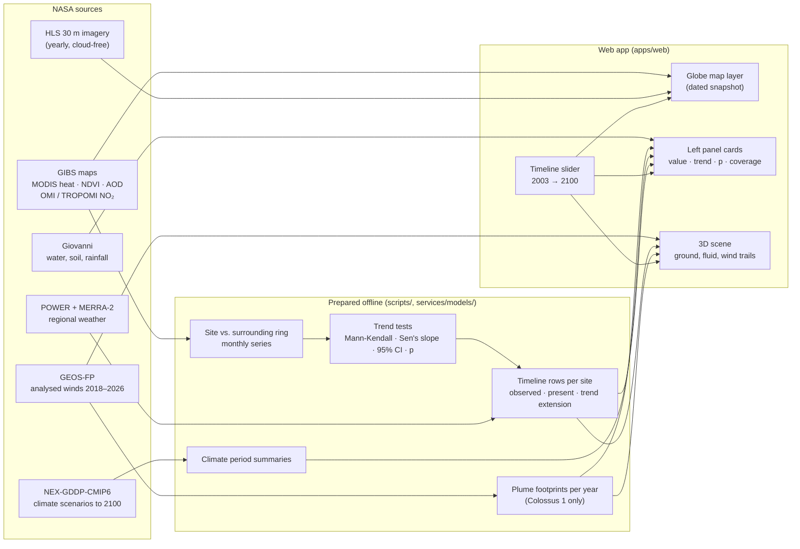

# How information reaches the viewer

This page follows a number from a NASA source to the screen, and shows what the viewer sees in each part of the timeline. The rule throughout: **every number on screen has a source, a date and an evidence label**. Visual effects (fluid, particles, ground colour) are driven by that data but are not measurements.

## 1. From NASA data to the screen

Moving the slider sends one `cs:year` event, so the map, the panel and the 3D scene always show the same site and year. If the map and the panel cover different periods (a single dated map against a 3-year average), the panel says so in its "Map: … / panel: …" line.

## 2. What each part of the timeline shows

| Era | Years | Map on the globe | Panel numbers | 3D scene | Label |
|---|---|---|---|---|---|
| **Observed** | 2003–2025 | The real NASA map for that year (season-matched) | Observed site and surrounding values, trend, p | Real yearly HLS ground; NASA POWER weather; observed greenness tints the ground | none (natural look) |
| **Present** | 2026 | Latest real map | Partial year, seasons removed | Latest imagery; "NOW" marker | NOW |
| **Trend extension** | 2027–2035 | **Nearest same-season real map**, captioned "not a projection" (satellites have no future maps) | Sen's-slope trend line and 95% CI band, which widens each year | Ground follows the trend value; the projection look is stylized | PROJECTED · IF THE TREND CONTINUES |
| **Climate scenarios** | 2036–2100 | No annual map | Regional NEX-GDDP-CMIP6 period summaries (SSP2-4.5 / SSP5-8.5, 5-model spread) | Climate context only; no facility effect | Regional scenario, not a facility forecast |

Two rules hold in every era:
- **Never fabricate data.** A year with no data says why ("No dispersion footprint for 2050", "Dispersion footprints start in 2018") and never reuses another year's result unlabelled.
- **Never attribute change from proximity alone.** Satellite change near a facility is evidence, not proof.

## 3. Each category, end to end

| Category | Observed evidence | Future view | What it is **not** |
|---|---|---|---|
| **Heat** | MODIS day/night surface heat, site minus surroundings; MERRA-2 regional air | Trend extension to 2035, then CMIP6 temperature and days ≥ 35 °C | Not the facility's own added heat |
| **Vegetation** | MODIS NDVI greenness, site minus surroundings | NDVI trend extension to 2035; after that, CMIP6 growing-condition drivers | Not plant death or crop yield |
| **Air** | OMI NO₂ (2005–), TROPOMI NO₂ (2023–), MODIS aerosol | Colossus 1: that year's dispersion footprint (2018–2026). Later years: no footprint, with the reason | χ/Q is dilution, not concentration. No µg/m³ without a sourced emission rate |
| **Water** | Giovanni groundwater, topsoil moisture, rainfall, evapotranspiration; USGS stations | CMIP6 rainfall scenarios | Water use, consumption and quality are separate quantities |

### Worked example: Colossus 1 greenness

1. MODIS NDVI tiles → site and ring averages → annual series 2003–2026.
2. Trend test: **−0.051 NDVI/decade, 95% CI −0.073 to −0.019, p = 0.006** (site minus surroundings: −0.059/decade, p = 0.003).
3. Timeline rows: 2025 observed 0.359 · 2026 present 0.359 · 2027 trend 0.348 (CI 0.320–0.388) · 2030 trend 0.332 (CI 0.299–0.383).
4. On screen in 2027: the panel shows 0.348 with the band; the 3D ground loses a little green; the globe map shows the July 2026 NDVI map labelled "nearest same-season map, not a projection".

The change from 2026 to 2027 is small. An earlier version showed the October 2026 map for every year after the record, which looked like sudden browning; maps are now matched to the season ([issue #11 audit](issue-11-data-audit.md), row 10).

### Worked example: Colossus 1 air dispersion

Only Colossus 1 has documented on-site combustion (methane gas turbines), so only it gets the purple fluid and a dispersion footprint (`site.effects.plume`). For each year from 2018 to 2026, a Gaussian plume runs on that year's analysed GEOS-FP winds (about 12 snapshots a year), so the footprint changes as you scrub: for example, in 2018 it drifts south and Boxtown gets 0% of the peak, while in 2025 it drifts north and Boxtown gets 2.2%. Future years show no footprint, because no analysed winds exist for them.

## Where this is implemented

| Step | Code |
|---|---|
| Series and trends | `scripts/precompute.py`, `apps/web/js/stats.js`, `services/models/trends/` |
| Timeline rows | `scripts/export_timeline.cjs` → `data/cloudshadow/unreal/timeline/` |
| Plume footprints | `services/models/projections/plume.py` → `data/cloudshadow/plumes/colossus1/<year>.json` |
| Climate scenarios | `services/models/projections/` → `data/cloudshadow/projections/` ([method](projections.md)) |
| Year sync and map choice | `apps/web/js/timeline.js` (`cs:year`), `apps/web/js/app.js` (`refreshOverlay`), `apps/web/js/map-source-window.js` |
| Panel text | `apps/web/js/environment-story.js`, `apps/web/js/future-data.js` |
