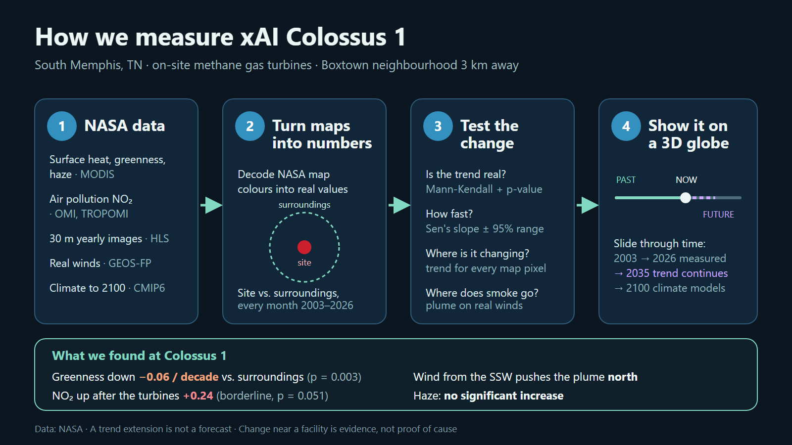
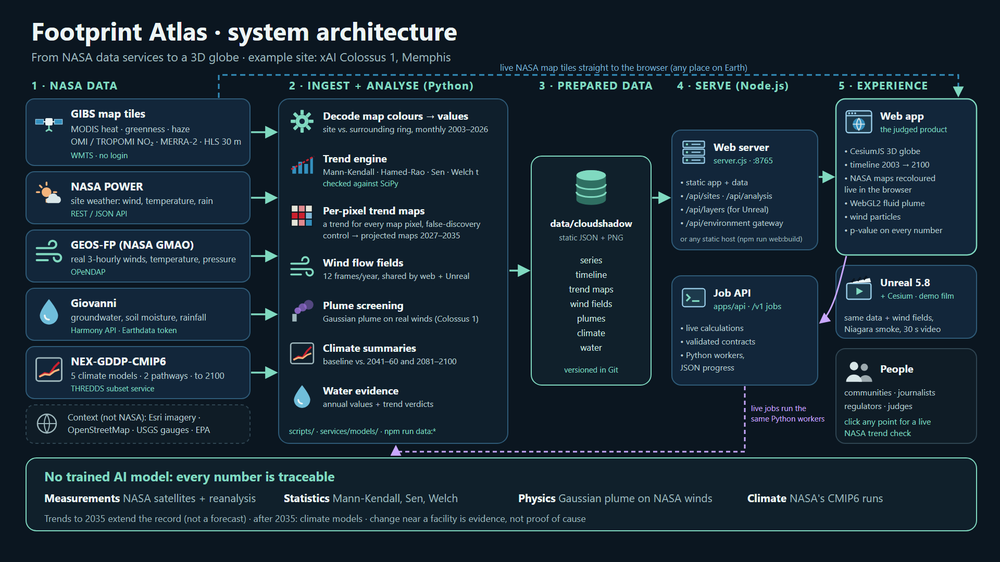

# Presentation kit: Footprint Atlas

Use this for the judged demo: **7 slides maximum, or a 30-second video** (English). Judging criteria: Impact, Creativity, Validity, Relevance (NASA data must be core), Presentation.

**Diagram for the "how it works" slide:** [`colossus1-how-it-works.png`](colossus1-how-it-works.png) (1600×900, drops straight into a 16:9 slide). An editable vector version is [`colossus1-how-it-works.svg`](colossus1-how-it-works.svg).

**Detailed architecture slide** (for technical questions): [`architecture.png`](architecture.png) (1920×1080; editable [`architecture.svg`](architecture.svg)).

**One-page cheat sheet for answering questions:** [cheat-sheet.md](cheat-sheet.md).

All the technical detail behind it (every dataset, API and model) is in [../technical-details.md](../technical-details.md).

---

## The story in one sentence

> AI data centers are being built faster than anyone can measure their local footprint. We use 20+ years of NASA satellite data to measure it, test whether the change is real, and show it on a 3D globe you can slide through time.

## 7-slide plan

| # | Slide | On screen | What to say (≈20–30 s each) |
|---|---|---|---|
| 1 | **The problem** | Photo or globe shot of xAI Colossus, Memphis. Title: *"What does an AI data center do to the place around it?"* | AI data centers need huge power. In South Memphis, xAI's Colossus runs methane gas turbines on site, about 3 km from the Boxtown neighbourhood. Neighbours ask: is the air, heat or land around us changing? Nobody measures it independently. |
| 2 | **Our idea** | App screenshot: globe, timeline, site pins. | Footprint Atlas is a 3D globe of five AI data-center sites. One slider moves through time, from 2003 to today, then to 2035 and 2100, and the map, numbers and 3D scene all change together. |
| 3 | **How it works** | **The diagram** (`colossus1-how-it-works.png`). | Four steps. (1) NASA satellites: heat, greenness, haze, NO₂, imagery, winds, climate models. (2) We turn NASA map colours back into real values, site vs. surroundings, every month since 2003. (3) We test whether the change is real (Mann-Kendall, p-value) and how fast (Sen's slope). (4) We show it on the globe with the uncertainty. |
| 4 | **What we found at Colossus 1** | Greenness map with the PROJECTED legend + the findings strip. | Greenness around the site fell 0.06 per decade more than its surroundings, p = 0.003. NO₂ rose after the turbines arrived, but only borderline (p = 0.051), and we say so. GEOS-FP winds come from the SSW, so the plume drifts north; Boxtown gets it on westerly days. Haze shows no significant increase. |
| 5 | **The future, honestly** | Timeline at 2030: projected map (dashed purple legend) next to the climate panel at 2080. | Until 2035 we extend each map pixel's own measured trend. That's a trend extension, not a forecast, and only pixels with a significant trend change. After 2035 we switch to NASA's CMIP6 climate models (5 models, two emissions pathways). |
| 6 | **Beyond Memphis** | Ashburn night heat (+0.25 °C/decade beyond surroundings, p = 0.001), plus the 5 pins. | It works for any site. Ashburn, Virginia (Data Center Alley): the region's air warmed 0.71 °C per decade, and the data-center area's night-time surface warmed a further 0.25 °C per decade beyond its surroundings. |
| 7 | **Why it matters + try it** | Link / QR code to the app, "Data: NASA" credits, team name. | Communities, journalists and regulators can check a data center's footprint themselves, with open NASA data and honest statistics. Every number shows its p-value; nearby change is evidence, not proof. |

**Award angles:** *Best Use of Data:* 7 NASA products, statistics validated against SciPy, every number with its p-value. *Best Storytelling:* one site and one slider, from past to future. *Art & Technology:* 3D globe, real wind particles, data-driven fluid plume.

## 30-second video script (if we submit the video instead)

| Time | Picture | Caption / voice |
|---|---|---|
| 0–4 s | Night-lights globe, slow orbit | "AI is being built here." |
| 4–9 s | Dive to Memphis, Colossus 1 pin | "xAI Colossus: gas turbines, 3 km from homes." |
| 9–16 s | Slider 2015 → 2026: imagery changes, purple plume grows, greenness map turns orange | "NASA satellites: greenness down, p = 0.003. NO₂ up, borderline." |
| 16–23 s | Push into 2030: PROJECTED legend, map keeps changing | "If the trend continues…" |
| 23–28 s | Ashburn night heat, numbers on screen | "Ashburn nights: +0.25 °C per decade, p = 0.001." |
| 28–30 s | Pull back to all pins, title card | "Footprint Atlas · Data: NASA" |

## Live demo path (2 minutes, if asked)

1. Open the app: it starts at **Colossus 1** (set with `FOOTPRINT_STORY_SITE`).
2. **Vegetation** button → slide 2005 → 2026: the orange (less green) area grows at the campus.
3. Slide past **2026**: the legend turns dashed purple, *"PROJECTED 2030"*. The map keeps changing, only where the trend is significant.
4. **Air** tab → 2025 → *Show dispersion in 3D*: that year's plume on real GEOS-FP winds. Move to 2018 to see the drift change.
5. Slide to **2080** → Heat: CMIP6 climate scenario (regional), with SSP2-4.5 / SSP5-8.5.
6. Zoom out: global wind trails from GEOS-FP.
7. Switch to **Ashburn** → night heat: the headline number.

Before the demo: run `npm run web`, open it once so tiles are cached, and check the Browser/GPU is not throttled. Keep this page's PNG as a backup slide if the network is slow.

## Likely judge questions

| Question | Answer |
|---|---|
| *Did you train a model?* | No machine-learning model. We use established statistics (Mann-Kendall with the Hamed-Rao autocorrelation correction, Sen's slope, Welch t-test), a standard Gaussian plume (Briggs/Pasquill), and NASA's own climate model runs (NEX-GDDP-CMIP6). All of these are transparent and checkable; our stats code is validated against SciPy. |
| *How do you know it's the data center and not the region?* | We always compare the site with a ring of surroundings, and for maps we test each pixel. Regional change (like night warming across Memphis) shows up everywhere; a site signal must beat it. Even then, nearby change is evidence, not proof. We say that on screen. |
| *Why only to 2035?* | A straight trend from ~23 years of data says little beyond ~9 years ahead. After 2035 we use physics-based climate models instead. |
| *Why is NO₂ "borderline"?* | p = 0.051 is just above 0.05. We report it honestly instead of rounding it into a finding. The turbines started in mid-2024, so the record after them is short. |
| *Why NO₂ from OMI, not TROPOMI?* | TROPOMI is sharper but only in GIBS from Sep 2023; OMI goes back to 2004, which is what a trend needs. |
| *Is the plume a pollution measurement?* | No. It's a dilution footprint (χ/Q) driven by real NASA winds. Without a sourced emission rate we never show µg/m³. |
| *Does it work elsewhere?* | Any point: click the globe for a live NASA trend analysis. The detailed 3D timeline is prepared for the 5 study sites. |
| *What's NASA's role?* | Every measurement: MODIS, OMI, TROPOMI (via GIBS), HLS, GEOS-FP, POWER/MERRA-2, Giovanni, NEX-GDDP-CMIP6. |

## Submission checklist

- [ ] ≤ 7 slides (or the 30-s video with English captions)
- [ ] Project page in English, GitHub link, app link
- [ ] References: NASA datasets (see technical-details.md), CesiumJS, Esri World Imagery, OpenStreetMap, news sources in `data/cloudshadow/sites.json`
- [ ] Submit on the Space Apps site before **Sun Nov 15, 11:59 pm**
