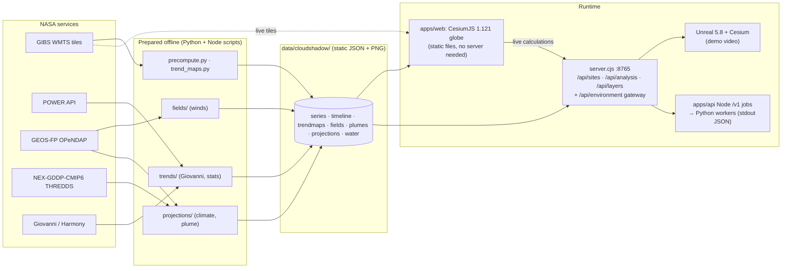

# Technical details: data, APIs and models

How Footprint Atlas gets its data, what it computes and which services it calls. For the simple version, see the [presentation diagram](presentation/colossus1-how-it-works.png); for what the viewer sees in each timeline era, see [information-flow.md](information-flow.md).

**Short answer to "what models did you train?"** None. There is no machine-learning model. Everything is:
1. **Measurements:** NASA satellite and reanalysis products.
2. **Established statistics:** trend tests and confidence intervals, validated against SciPy.
3. **One standard physics screening model:** a Gaussian plume driven by NASA winds.
4. **NASA's own pre-run climate model ensemble:** NEX-GDDP-CMIP6.

That keeps every number traceable and explainable.

## 1. Data sources and how each is fetched

| What | NASA product | Access (API) | Auth | Code | Output |
|---|---|---|---|---|---|
| Day / night surface heat | MODIS Terra LST 8-day, ~1 km (`MODIS_Terra_L3_Land_Surface_Temp_8Day_Day/Night`) | **NASA GIBS WMTS** map tiles `gibs.earthdata.nasa.gov/wmts/epsg3857/best/<layer>/default/<date>/<matrix>/<z>/<y>/<x>.png` | none | `scripts/precompute.py`, live: `apps/web/js/layers.js` | `data/cloudshadow/series/<site>.json` |
| Greenness | MODIS Terra NDVI 16-day, ~250 m | GIBS WMTS | none | same | same |
| Haze (particles) | MODIS Terra AOD 3 km, daily | GIBS WMTS | none | same | same |
| NO₂ (long record) | Aura **OMI** tropospheric NO₂, daily, 13×24 km, 2004– | GIBS WMTS | none | same | same |
| NO₂ (recent, sharp) | Sentinel-5P **TROPOMI** NO₂, ~5 km, in GIBS since Sep 2023 | GIBS WMTS | none | same | same |
| Regional air temperature | **MERRA-2** 2 m air temperature, monthly | GIBS WMTS | none | same | same |
| Yearly ground imagery | **HLS** (Harmonized Landsat Sentinel-2) 30 m, cloud-free date per year | GIBS WMTS + NASA **CMR** search | none | `scripts/hls_timeline.py` | `data/cloudshadow/hls_timeline.json` |
| Weather at each site | **NASA POWER** daily/monthly: wind 10 m, direction, temperature, rain, humidity | `power.larc.nasa.gov/api/temporal/...` REST/JSON | none | `scripts/fetch_weather.py`, `services/data/` | `data/cloudshadow/weather/` |
| Real wind fields (and T, sea-level pressure) | **NASA GMAO GEOS-FP** assimilation, 0.25°, 3-hourly (`inst3_2d_asm_Nx`) | **OPeNDAP** `opendap.nccs.nasa.gov/dods/GEOS-5/fp/0.25_deg/assim/...` | none | `services/models/fields/` | `data/cloudshadow/fields/` (PNG atlases + JSON, shared with Unreal) |
| Water, soil, rainfall, ET, groundwater; OMI NO₂ area averages | GPM IMERG, GLDAS, GRACE-assimilated groundwater, OMI (via **Giovanni**) | **Giovanni / Harmony** `harmony.earthdata.nasa.gov`, `api.giovanni.earthdata.nasa.gov` | Earthdata token (`EARTHDATA_TOKEN` in `.env`) | `services/models/trends/giovanni.py`, `water_summary.py` | `data/cloudshadow/water/<site>.json` |
| Climate scenarios to 2100 | **NASA NEX-GDDP-CMIP6** daily, 0.25°: 5 models (ACCESS-CM2, GFDL-ESM4, MPI-ESM1-2-HR, MRI-ESM2-0, UKESM1-0-LL), SSP2-4.5 and SSP5-8.5 | **THREDDS NetCDF Subset Service** `ds.nccs.nasa.gov/thredds/ncss/grid/AMES/NEX/GDDP-CMIP6/...` (`temporal=all`) | none | `services/models/projections/nexgddp.py`, `build.py` | `data/cloudshadow/projections/<site>.json` |
| Annual climate path | NASA POWER climate projections (NEX-GDDP-CMIP6 ensemble) | NASA POWER API | none | `services/data/` | `data/cloudshadow/power-projections/` |

**Non-NASA context (labelled as such in the app):**
- Esri World Imagery: the globe's base map.
- OpenStreetMap via the Overpass API: buildings, roads and campuses for the 3D neighbourhoods.
- USGS Water Data API: stream gauges.
- EPA and Canada NPRI inventories: facility candidates.
- Open-Meteo / CAMS: an optional air-quality cross-check in the Node API.
- News sources for site facts are listed in `data/cloudshadow/sites.json`.

### How a NASA map becomes a number

GIBS serves colour PNG tiles, not raw data. Each layer has an official GIBS colormap (XML) that maps every colour to a value interval. We:
1. Download the tiles covering the site (cached in `.tilecache/`).
2. Look up each pixel's RGB in the colormap and take the class midpoint.
3. Drop transparent and no-data pixels.
4. Average a small **site window** and a **surrounding ring**. The ring is sized per variable: heat 6–20 km, NDVI 4–12 km, AOD 15–40 km, OMI NO₂ 30–70 km.

The browser does exactly the same for any clicked point (`layers.js`), so live results match the prepared ones.

## 2. Analysis: what is computed

| Step | Method | Where |
|---|---|---|
| Remove the seasons | Monthly anomalies against each calendar month's mean (de-seasoning) | `apps/web/js/stats.js`, `services/models/trends/series.py` |
| Is there a trend? | **Mann-Kendall** test (seasonal variant for monthly data); **Hamed-Rao** correction for autocorrelation, which may only widen uncertainty | `stats.js`, `services/models/trends/stats.py` |
| How fast? | **Sen's slope** with 95% confidence interval, per decade | same |
| Before vs. after (e.g. turbines, mid-2024) | **Welch t-test** with autocorrelation-adjusted effective sample size | `stats.js` |
| Site vs. region | Site series minus surrounding ring ("local signal"); the regional trend is the climate control a site must beat | `stats.js`, `trend-analysis` job |
| Validation | Unit tests compare our implementations with SciPy (`scipy.stats`) results | `tests/`, `services/models/tests/` |

## 3. Predictions and scenarios

| Horizon | What | Method | Honest label |
|---|---|---|---|
| 2027–2035, site numbers | Trend extension of each variable (site and site minus surroundings) | Sen's-slope line from the full record; 95% band from the slope CI, widening with time | "If the historical trend continues", not a forecast |
| 2027–2035, **maps** | Projected map for heat (day and night), greenness, NO₂ and haze | `scripts/trend_maps.py`: per pixel, July-season median per year, Sen's slope, Mann-Kendall + Hamed-Rao, **Benjamini-Hochberg** false-discovery control at q < 0.10 (Wilks 2016) across the map. The browser adds slope × years to the latest real map; non-significant pixels don't change | "PROJECTED <year>" legend, dashed purple |
| 2036–2100 | Regional climate: mean temperature, days ≥ 35 °C, rainfall | NEX-GDDP-CMIP6 5-model ensemble; baseline 1995–2014 vs 2041–2060 and 2081–2100; SSP2-4.5 / SSP5-8.5 | "Regional scenario, not a facility effect" |
| 2018–2026, Colossus 1 only | Air dispersion footprint per year | Gaussian plume: Briggs (1973) urban/rural σ curves, Pasquill stability from 10 m wind, ground reflection, ~12 GEOS-FP analysed wind instants per year → χ/Q dilution grid | "Relative dilution, not concentration"; no µg/m³ without a sourced emission rate |
| Any year 2020–2100 (user inputs) | Local impact screening: heat, air, water balance, noise | Python screening worker with user-supplied, cited inputs; same inputs per year unless changed | "Conditional screening, not a calibrated prediction" |

Why the trend extension stops at 2035: a straight line from ~23 years of data is not meaningful much beyond ~9 years, and it has no physics. After that, climate models take over ([information-flow.md](information-flow.md#why-site-trend-extensions-stop-at-2035)).

## 4. System architecture



- **Web app** (`apps/web`) is the judged product. It's plain ES modules with CesiumJS. It reads prepared JSON, streams NASA GIBS tiles live, and recolours them in the browser on a fixed scientific colour scale. It deploys as static files (`npm run web:build`).
- **Local API** (`apps/web/server.cjs`, port 8765) serves the same data, `/api/analysis?site=&var=` for Unreal, and a gateway to the environmental job service.
- **Job service** (`apps/api`, Node/TypeScript): validated `/v1` jobs (trend analysis, climate projection, plume scenario, screening, air quality, water). They run Python workers that stream JSON progress on stdout. Contracts are in `packages/contracts/`.
- **Visual effects** are driven by data but are not measurements: wind particles from GEOS-FP; a WebGL2 stable-fluids smoke sim (purple, Colossus 1 only); a low-poly ground tinted by the evidence raster.

## 5. Commands

```bash
npm run data:nasa
```
GIBS → site series (needs `pip install pillow`).

```bash
npm run data:weather
```
NASA POWER weather.

```bash
npm run data:fields
```
GEOS-FP wind and temperature fields.

```bash
npm run data:trend-maps
```
Per-pixel trend maps for projected years.

```bash
npm run data:unreal
```
Timeline rows for web and Unreal.

```bash
npm run web
```
Run the app and API on http://localhost:8765.

```bash
npm run check
```
Typecheck plus Node, data, model and web tests.

## 6. Limits we state on screen

- Satellite change near a facility is evidence, not proof of attribution.
- Trend extensions are not forecasts; projected maps change only where a pixel's own trend is significant.
- MODIS AOD has gaps at Colossus 1, where the site pixel has 1–6 valid months per year; OMI NO₂ is coarse (13×24 km).
- The plume shows dilution only; there is no chemistry, background or monitor calibration.
- No facility operating data (power draw, emissions) is public, so expansion scenarios need user-supplied, cited inputs.
