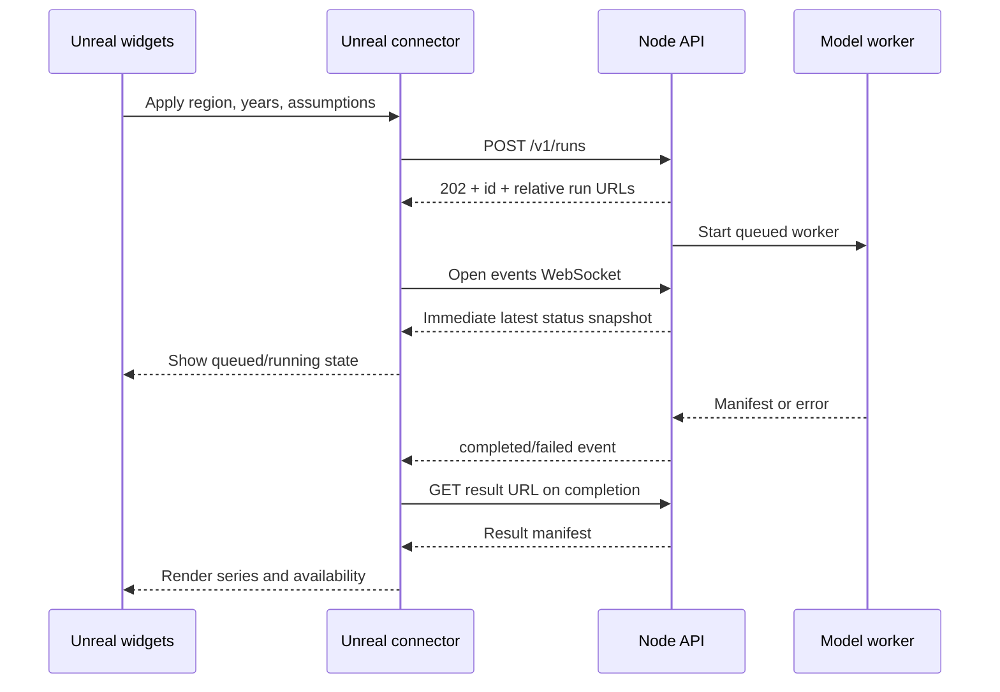

# Unreal + Cesium integration plan

> **Archived starter connector plan:** the generic scenario connector, accounting-result examples and acceptance checklist below are retained design notes. The active environmental `:3000` API accepts the supported operation kinds in [the current API](api.md) and [Data and backend](data-and-backend.md); it rejects the old synthetic scenario body. The repository already contains an [Unreal project and setup workflow](../clients/unreal/README.md) plus the [web explorer, statistics and separate `:8765` API](../apps/web/README.md). Those implementations remain intact; no automatic bridge from them to the expanded environmental gateway is supplied here. Electricity-bill, employment/labor and population controls in the archived plan are outside current scope.

This document preserves the original networking and scenario-UI proposal. Follow the existing client guides for the team's implemented globe, assets and timeline, and the active API documents when adding environmental requests.

## Target experience

Users navigate the globe, select a data-center cluster, inspect historical environmental trends, edit scenario assumptions, and compare future scenarios. Intended layers cover air emissions/quality, water availability/quality, electricity consumption and bills, employment/unemployment, population, land/ecosystem indicators, and noise.

The initial model supplies only four synthetic accounting series. Start the UI with charts and explicit availability labels. Leave unimplemented spatial layers disabled, with the reason from the result manifest. Do not draw illustrative noise contours or pollutant plumes from those accounting totals.

## 1. Establish the globe project

1. Choose a supported Unreal Engine/Cesium plugin combination and record the exact versions when creating the project. Follow the vendor quickstart rather than assuming every release has the same editor UI.
2. Create the project under `clients/unreal/`, enable Cesium for Unreal, and configure the globe's georeferencing and navigation.
3. Use Cesium World Terrain as a possible base, or add Google Photorealistic 3D Tiles through the supported Cesium workflow. Coverage/detail varies; do not assume every location has equally detailed buildings.
4. Keep provider credentials/configuration out of committed assets and config. Use appropriately restricted client-side provider tokens where needed; do not embed NASA login passwords or backend secrets in a packaged client.
5. Add independently sourced facility points and analysis boundaries as georeferenced objects. Retain their provenance instead of extracting facilities or terrain from Google imagery.

Sources: [Cesium quickstart](https://cesium.com/learn/unreal/unreal-quickstart/), [Google tiles in Cesium for Unreal](https://cesium.com/learn/unreal/unreal-photorealistic-3d-tiles/), and [Google Map Tiles policies](https://developers.google.com/maps/documentation/tile/policies). Preserve required attribution and provider data-use limits.

## 2. Build one networking component

Implement a `UGameInstanceSubsystem` or equivalent long-lived connector that owns the API base URL, current run ID, outstanding HTTP requests, WebSocket connection, and cached results. Expose its completed/status/error events to Blueprint UI widgets.

Planned public operations:

| Connector operation | API interaction |
| --- | --- |
| `CheckBackend` | `GET /health` |
| `LoadDomains` | `GET /v1/domains` |
| `SubmitScenario` | `POST /v1/runs` |
| `RefreshRun` | `GET` the returned `statusUrl` |
| `WatchRun` | Connect to the returned `eventsUrl` as WS/WSS |
| `LoadResults` | `GET` the returned `resultUrl` after completion |
| `Disconnect` | Close local subscriptions when leaving the view/shutting down |

These operation names are proposed client methods, not implemented C++ classes or additional backend endpoints. Use a C++ wrapper around Unreal's HTTP and WebSockets modules for Blueprint-friendly callbacks. Epic also documents an HTTP Blueprint plugin, currently marked Experimental; evaluate that choice against the selected engine version rather than treating it as a shipped production connector.

Primary references: [HTTP module](https://dev.epicgames.com/documentation/en-us/unreal-engine/API/Runtime/HTTP/FHttpModule), [IWebSocket](https://dev.epicgames.com/documentation/unreal-engine/API/Runtime/WebSockets/IWebSocket?lang=en-US), and [HTTP Blueprint plugin](https://dev.epicgames.com/documentation/en-us/unreal-engine/API/PluginIndex/HttpBlueprint).

Unreal only calls the Node gateway for simulation work. Python workers never need public endpoints accessible by the game client. Cesium's base-map requests remain a separate provider connection.

## 3. Wire the request flow

Detailed client behavior:

1. Load the local API URL from configuration. Use `http://127.0.0.1:3000` and `ws://` only for local development. A remote backend needs authenticated HTTPS/WSS. On another device, `127.0.0.1` refers to that device, not the developer's computer.
2. Serialize scenario inputs according to [the contract](api.md). Submit when the user applies changes or presses **Run scenario**, not on every rendered frame or slider movement.
3. Store the returned ID and URLs. Resolve relative URLs against the configured API origin. Convert the events URL's scheme from HTTP to WS, or HTTPS to WSS.
4. Subscribe to `run.status`; the first event is a latest-state snapshot, so completion before subscription is handled. On reconnect, fetch HTTP status before deciding to resume waiting. Polling `statusUrl` is a valid simpler first implementation.
5. When completed, fetch results once and cache the manifest and series by run ID. When failed, show the recorded error and offer an explicit new run. Do not treat an error as a numeric result.
6. On teardown, close the socket and detach callbacks. Apply parsed results on the appropriate Unreal game-thread context; do not block rendering while waiting for network responses.

The starter's WebSocket is status-only. Cancellation, pause/resume, durable event replay, and live partial scientific outputs are future work. Do not send those controls to the existing socket.

## 4. Build the UI and rendering adapters

| UI component | Implementation responsibility |
| --- | --- |
| Region/facility selector | Store independently sourced site identifiers and analysis boundaries |
| Scenario editor | Collect load, utilization, efficiency, growth, cooling, energy-source, and later domain-specific assumptions |
| Run-status panel | Display queued/running/completed/failed, including errors |
| Timeline | Read cached `series` samples for a selected year; mark missing samples explicitly |
| Metric charts | Read units/status/uncertainty from each metric; never hardcode a unit across domains |
| Layer manager | Initially display no model raster layers because `layers` is empty; later load documented geospatial layer formats |
| Comparison panel | Compare compatible baseline/intervention runs with the same geography, horizon, and model/evidence versions |
| Evidence panel | Show source IDs, assumptions, model version, warnings, and unsupported domains |

Annual accounting values must not be animated as hourly observations. Future interpolation or smoothing must be labeled as display behavior and must not invent more frequent scientific output. Detailed Cesium geometry is not evidence of building-scale prediction accuracy.

## 5. Treat editable terrain as a separate local asset

Google's streamed 3D tiles are not sculptable Unreal Landscape actors. For an editable local patch, use independently sourced elevation/geometry and your own Landscape or dynamic mesh. A Cesium cartographic polygon can visually hide overlapping tiles; its visual clipping does not by itself remove the original collision geometry. Design and verify collision separately.

Sources: [Cesium cartographic polygons](https://cesium.com/learn/unreal/unreal-clipping/), [Unreal Landscape](https://dev.epicgames.com/documentation/en-us/unreal-engine/landscape-outdoor-terrain-in-unreal-engine), and [runtime dynamic mesh support](https://dev.epicgames.com/documentation/en-us/unreal-engine/geometry-scripting-users-guide-in-unreal-engine).

Facility placement, terrain, cooling, or vegetation edits only influence model results if converted into supported numerical inputs. A visual factory, tree, or river edit does not automatically change pollution, runoff, noise, bills, or employment. Preserve the original observed scene and label the edited scene as a scenario.

Google's policies restrict extracting/deriving terrain or analytical data from its content. Keep independently sourced model data and your own scenario geometry separate from the streamed background. This project should not bake or bulk-download Google tiles into the repository.

## Acceptance checks for the future Unreal client

- Start the Node API and submit `data/examples/scenario.json` from the client.
- Show both immediate-completion and delayed/failed run paths without freezing the globe.
- Disconnect/reconnect events and recover using HTTP status.
- Render the four illustrative chart series and every unsupported-domain explanation.
- Show synthetic provenance and unquantified uncertainty; no real-world accuracy claims.
- Move the year slider without creating another run; apply changed assumptions to create a new one.
- Keep provider attribution visible and verify georeferencing of independently sourced data.
- Distinguish local visual terrain edits from supported model inputs and check collision explicitly.
